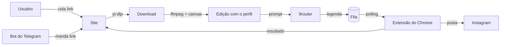

# Reel Autopost

Sistema que pega um link de vídeo do Instagram ou TikTok, edita com a identidade visual do usuário, gera uma legenda nova com IA e posta sozinho no Instagram dele.

São três peças que trabalham juntas:

| Peça | Pasta | O que faz |
|---|---|---|
| **Site** | [`site/`](site) | Contas, personalização (foto, nome, @, frase), fila de vídeos, edição com ffmpeg, legendas, bot do Telegram |
| **9router** | [`9router/`](9router) | Gateway de IA compatível com a API da OpenAI. Gera as legendas usando as contas de IA do dono |
| **Extensão** | [`extension/`](extension) | Extensão do Chrome que pega os vídeos prontos da fila e posta no Instagram pelo navegador do usuário |

> **Instalação completa (local + Discloud), escrita pra uma IA executar passo a passo:** [`docs/INSTALACAO.md`](docs/INSTALACAO.md)

---

## Como funciona



1. O usuário cria conta no site e personaliza o perfil (foto, nome, @, frase).
2. O site gera um **código de dispositivo** `XXXX-XXXX` (vale 10 min, uso único). A extensão troca esse código por um token próprio.
3. Cada link colado no site (ou mandado pro bot do Telegram) entra na fila:
   baixa (yt-dlp) → edita com o perfil (ffmpeg + `@napi-rs/canvas`) → limpa metadados → gera legenda no 9router → fica **Na fila da extensão**.
4. A extensão consulta a fila a cada 30 s (ou na hora, se o site estiver aberto no mesmo Chrome), abre o Instagram e posta com a foto de perfil como capa. O resultado volta pro site.
5. O 9router é configurado só no servidor. Usuários nunca veem nem configuram IA; todos usam a do dono, com limite de `CAPTIONS_PER_HOUR` por conta.

---

## Estrutura do repositório

```
.
├── site/                    App Reel Autopost (Node, sem framework)
│   ├── server.js            Servidor HTTP, rotas, fila, bot do Telegram
│   ├── lib/                 caption (9router), db (SQLite), media (yt-dlp/ffmpeg),
│   │                        overlay (canvas), extension-zip, telegram, env
│   ├── public/              Front-end (HTML/CSS/JS puro)
│   ├── assets/fonts/        Fontes usadas na arte do vídeo
│   ├── prompt.md            Prompt da legenda
│   ├── discloud.config      Config do app na Discloud
│   └── .env.example         Todas as variáveis de ambiente, comentadas
├── 9router/                 App do 9router pra Discloud
│   ├── start.js             Sobe o servidor do 9router na porta 8080
│   ├── discloud.config
│   └── data/                (ignorado) cópia do ~/.9router configurado
├── extension/               Fonte da extensão do Chrome (Manifest V3)
├── scripts/
│   ├── build-site.sh        Monta dist/site pra subir na Discloud
│   ├── obfuscate-extension.mjs   Gera site/extension-dist (versão ofuscada que o site distribui)
│   └── sync-9router-data.sh Copia ~/.9router → 9router/data e trava login + API key
└── docs/
    └── INSTALACAO.md        Passo a passo completo
```

---

## Início rápido (local)

Requisitos: **Node 22.13+**, **ffmpeg**, **Python 3** (pro yt-dlp no Mac) e o **9router** rodando.

```bash
npm run setup                          # instala dependências da raiz e do site
cp site/.env.example site/.env         # ajuste se precisar
python3 -m venv site/.venv && site/.venv/bin/pip install -q yt-dlp
npm start                              # gera a extensão e sobe o site
```

Abra http://localhost:9283, crie uma conta, baixe a extensão pelo próprio site e conecte com o código.

## Deploy (Discloud)

```bash
npm run sync:9router                                   # 9router local → 9router/data
cd 9router && discloud app commit <id-do-9router>      # ou "discloud app upload" na 1ª vez
cd .. && npm run build:site                            # monta dist/site
cd dist/site && discloud app commit <id-do-site>
```

Detalhes, primeira subida, subdomínios e verificação: [`docs/INSTALACAO.md`](docs/INSTALACAO.md).

---

## Variáveis de ambiente (site)

Todas documentadas em [`site/.env.example`](site/.env.example).

| Variável | Padrão | Uso |
|---|---|---|
| `PORT` | `9283` | Porta HTTP. **8080 na Discloud** |
| `HOST` | (todas) | `0.0.0.0` na Discloud |
| `PUBLIC_URL` | `http://localhost:PORT` | URL pública; vai no cookie e na extensão baixada |
| `TRUST_PROXY` | — | `1` atrás de proxy (Discloud) |
| `ROUTER_URL` | `http://localhost:20128/v1/chat/completions` | Endpoint do 9router |
| `ROUTER_KEY` | chave ativa do `~/.9router` | API key do 9router (obrigatória em produção) |
| `ROUTER_MODELS` | `cc/claude-opus-5-5,…` | Modelos tentados em ordem |
| `CAPTIONS_PER_HOUR` | `40` | Limite por usuário |
| `WORKERS` | `2` | Jobs simultâneos (**1** na Discloud) |
| `FFMPEG_THREADS` | `2` | Threads do ffmpeg |
| `IG_BROWSER` / `IG_COOKIES` | — | Cookies do Instagram pro yt-dlp |
| `YTDLP` | auto | Caminho de um yt-dlp específico |
| `TELEGRAM_BOT_TOKEN` | — | Liga o bot do Telegram |

## Segurança

- Nenhuma credencial fica no repositório. `.env`, `.env.production`, `production.env`, `cookies.txt`, `site/data/` e `9router/data/` estão no `.gitignore`.
- O 9router publicado sobe com `requireLogin` e `requireApiKey` ligados (o `sync-9router-data.sh` força isso na cópia).
- A extensão distribuída pelo site é a versão ofuscada; a fonte legível fica só em `extension/`.

## Problemas comuns

| Sintoma | Causa | Solução |
|---|---|---|
| `ERR_CONNECTION_RESET` ao abrir o site, mas a Discloud diz que está online | Firewall da rede (empresa/faculdade) bloqueando `*.discloud.dev` | Teste em outra rede (4G). Use domínio próprio |
| `Instagram sent an empty media response` | Instagram bloqueou download anônimo | Configure `IG_COOKIES`/`site/cookies.txt` |
| `This content isn't available to everyone` | Post com restrição de idade/região | Mesmo caso: precisa de cookies de conta logada |
| Site reinicia sem log na Discloud | Falta de RAM no ffmpeg | `WORKERS=1`, RAM do site ≥ 1536 MB |
| Telegram `409 Conflict` | Dois servidores usando o mesmo token | Desligue o bot no servidor local |
| Arquivo velho servido depois de deploy | Cache do Cloudflare da Discloud por extensão | Rotas dinâmicas usam `Cache-Control: no-store` |
